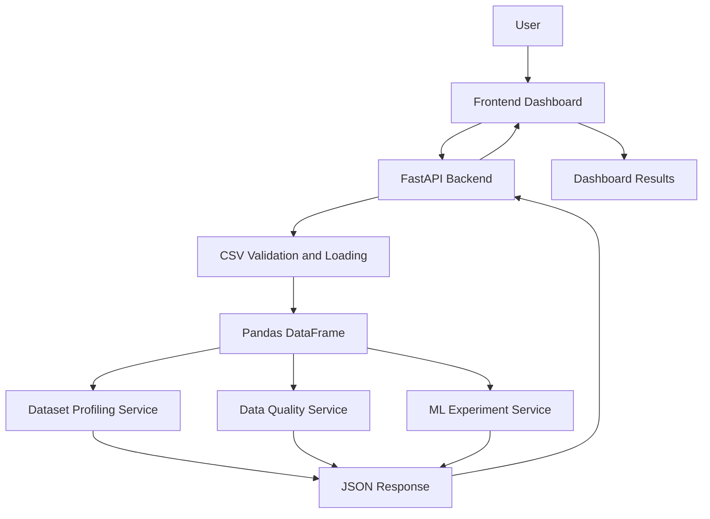

# Dataset Doctor

**An AI/ML Dataset Health and Experiment Platform**

Dataset Doctor is a web-based platform that helps users inspect, analyze, and evaluate CSV datasets before building machine learning models.

It automatically profiles uploaded datasets, identifies common data quality issues, and allows users to run baseline machine learning experiments for classification and regression tasks.

## Features

### Dataset Upload
- Upload CSV datasets through a web interface.
- Validate file type, size, and CSV structure.
- Handle invalid or malformed datasets.

### Dataset Profiling
- Display dataset dimensions (rows and columns).
- Identify missing values and their percentages.
- Detect duplicate records.
- Display column data types and unique values.
- Generate descriptive statistics for numerical columns.
- Summarize categorical columns.

### Data Quality Analysis
- Detect missing values.
- Identify duplicate rows.
- Detect potential identifier columns.
- Identify constant columns.
- Check class imbalance in classification targets.

### Machine Learning Experiments
- Select a target column.
- Choose classification or regression.
- Automatically preprocess numerical and categorical features.
- Handle missing feature values.
- Train baseline machine learning models.
- Evaluate and compare model performance.

### Model Evaluation
**Classification metrics:**
- Accuracy
- Precision
- Recall
- F1-score

**Regression metrics:**
- Mean Absolute Error (MAE)
- Root Mean Squared Error (RMSE)

### Interactive Dashboard
- View dataset profiling and quality reports.
- Run experiments through the browser.
- Compare model performance in a results table.
- Identify the best-performing model based on the selected evaluation metric.


## Technology Stack

| Layer | Technology | Purpose |
|---|---|---|
| Frontend | HTML5 | Application structure |
| Frontend | CSS3 | Responsive dashboard design |
| Frontend | JavaScript | User interactions and API integration |
| Backend | Python | Core application logic |
| Backend Framework | FastAPI | REST API development |
| Data Processing | Pandas | CSV processing and dataset analysis |
| Machine Learning | Scikit-learn | Preprocessing, model training and evaluation |
| Server | Uvicorn | Running the FastAPI application |
| Version Control | Git and GitHub | Source code management |

## System Architecture

Dataset Doctor follows a modular architecture that separates the frontend, backend API, dataset profiling, data quality analysis, and machine learning functionality.

### Architecture Diagram



### Application Workflow

1. The user uploads a CSV dataset through the frontend.
2. JavaScript sends the dataset to the FastAPI backend.
3. The backend validates the uploaded file and loads it into a Pandas DataFrame.
4. The profiling service generates dataset statistics.
5. The quality service identifies potential data quality issues.
6. The user selects a target column and machine learning task.
7. The ML experiment service preprocesses the data, trains baseline models, and calculates evaluation metrics.
8. The backend returns results as JSON.
9. The frontend displays profiling information, quality reports, and model comparisons.

## Project Structure

```text
datasetDoctor/
│
├── backend/
│   ├── app/
│   │   └── services/
│   │       ├── __init__.py
│   │       ├── profiling.py
│   │       ├── quality.py
│   │       └── ml_experiment.py
│   │
│   ├── examples/
│   │   └── fixtures/
│   │
│   ├── learning/
│   │
│   ├── tests/
│   │
│   ├── main.py
│   └── requirements.txt
│
├── frontend/
│   ├── index.html
│   ├── css/
│   │   └── style.css
│   └── js/
│       └── app.js
│
├── docs/
│
├── .gitignore
└── README.md
```


## Installation and Setup

Follow these steps to run Dataset Doctor locally.

### Prerequisites

Make sure you have installed:

- Python 3.13 or compatible version
- Git
- Visual Studio Code
- VS Code Live Server extension

### 1. Clone the Repository

```bash
git clone https://github.com/ashifzayn01/datasetDoctor.git
cd datasetDoctor
```

### 2. Set Up the Backend

Navigate to the backend directory:

```bash
cd backend
```

Create a virtual environment:

```bash
python -m venv venv
```

Activate it on Windows PowerShell:

```powershell
.\venv\Scripts\Activate.ps1
```

Install dependencies:

```bash
pip install -r requirements.txt
```

### 3. Start the Backend Server

```bash
uvicorn main:app --reload
```

The backend will run at:

```text
http://127.0.0.1:8000
```

Interactive API documentation:

```text
http://127.0.0.1:8000/docs
```

### 4. Start the Frontend

1. Open the `frontend` folder in VS Code.
2. Open `index.html`.
3. Right-click and select **Open with Live Server**.

The frontend should open at:

```text
http://127.0.0.1:5500
```

Make sure the backend is running before using the dashboard.

## API Documentation

Dataset Doctor provides REST API endpoints through FastAPI.

| Method | Endpoint | Description |
|---|---|---|
| GET | `/` | Returns the application welcome message |
| GET | `/health` | Checks backend health |
| POST | `/api/datasets/upload` | Uploads and analyzes a CSV dataset |
| POST | `/api/experiments/run` | Runs a machine learning experiment |

### Upload Dataset

**Endpoint:** `POST /api/datasets/upload`

Accepts a CSV file and performs:

- File validation
- Dataset loading
- Dataset profiling
- Data quality analysis

**Request:** Multipart form data containing the CSV file.

### Run ML Experiment

**Endpoint:** `POST /api/experiments/run`

Accepts:

| Parameter | Type | Description |
|---|---|---|
| file | UploadFile | CSV dataset |
| target_column | String | Column to predict |
| task_type | String | `classification` or `regression` |

Returns experiment information, trained model results, and evaluation metrics.

### Interactive API Testing

FastAPI provides Swagger UI for exploring and testing endpoints:

`http://127.0.0.1:8000/docs`


## Screenshots

Add screenshots of the application to demonstrate its functionality.

Suggested screenshots:

1. Main dashboard
2. Dataset profiling results
3. Data quality report
4. Machine learning experiment results
5. Model comparison table

Store the screenshots in `docs/screenshots/`.

## Future Improvements

Potential areas for extending Dataset Doctor:

- Automatic classification and regression task detection.
- Advanced data quality recommendations.
- Additional machine learning algorithms.
- Hyperparameter tuning.
- Experiment history and result persistence.
- Downloadable dataset analysis reports.
- Interactive data visualizations.
- Deployment with a publicly accessible frontend and backend.

## Learning Outcomes

Building Dataset Doctor provided practical experience with:

- Developing REST APIs using FastAPI.
- Processing and analyzing datasets using Pandas.
- Building machine learning pipelines with Scikit-learn.
- Handling missing values and categorical features.
- Evaluating classification and regression models.
- Integrating a JavaScript frontend with a Python backend.
- Organizing a modular Python application.
- Testing API workflows and handling invalid inputs.